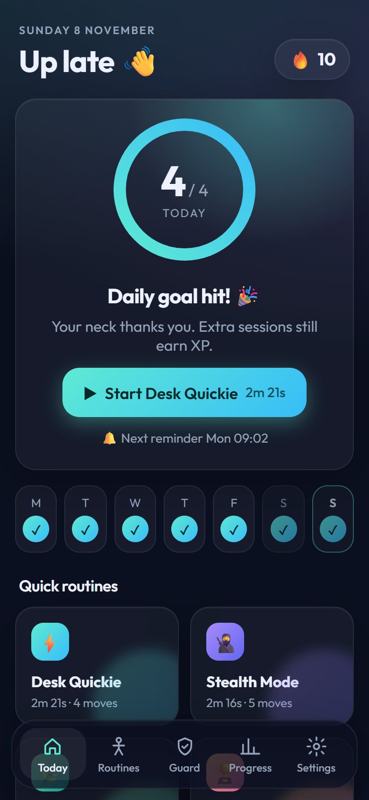
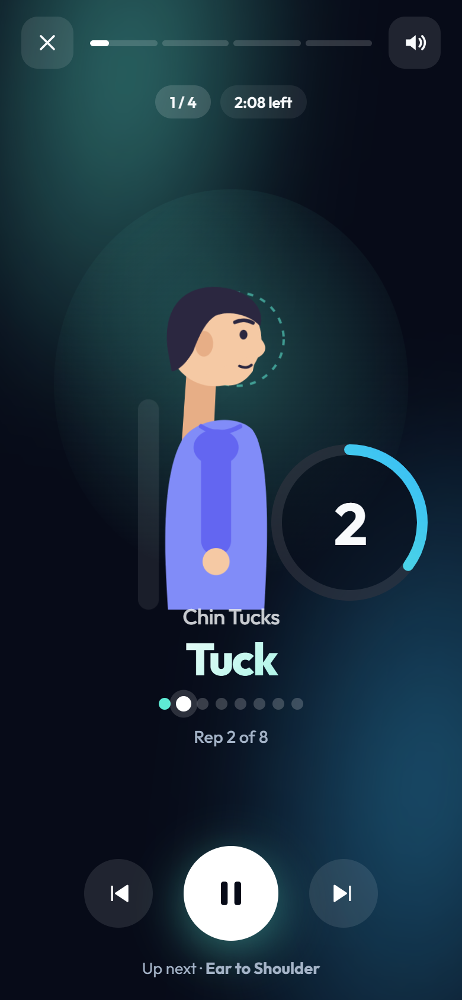
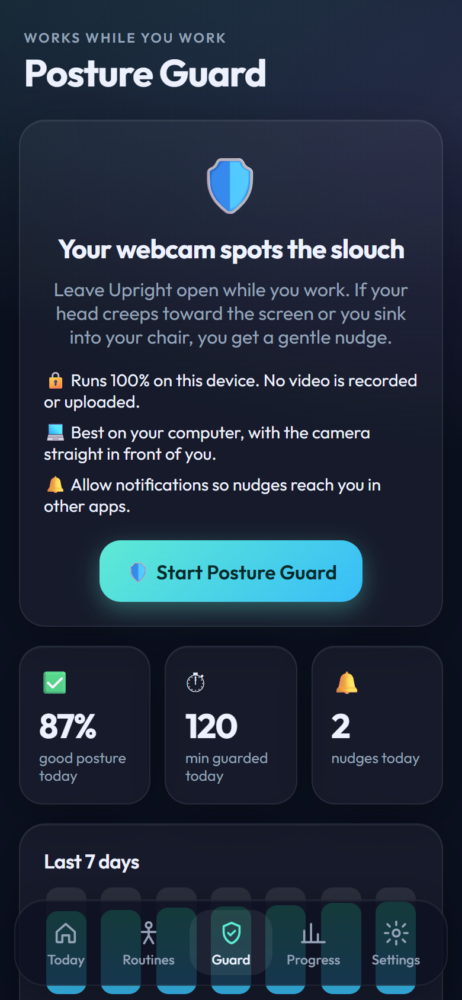
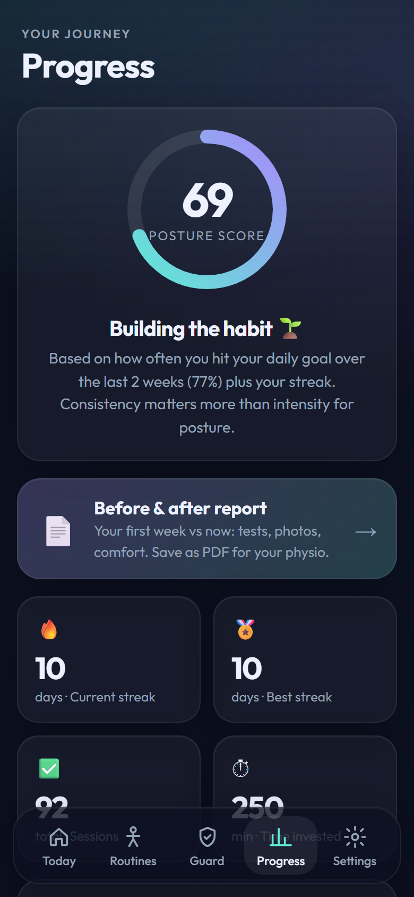
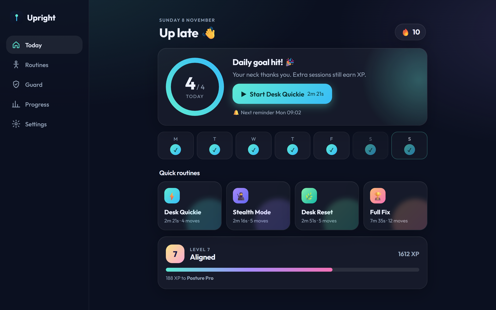

# Upright 🧘‍♂️ undo the desk, one short break at a time

A free posture coach that runs in your browser and installs like an app on your phone and computer, with a desktop app for Windows and Mac. The code is public and free for non-commercial use ([license](#license)).

- It asks **what bothers you** (neck, shoulders & upper back, lower back, hips, legs & calves, stress & tension) and only shows exercises for those, with an optional **4-week plan** that starts gentle and gets stronger.
- It **reminds you** to take exercise breaks, stand up for a **quick stretch**, rest your eyes and switch your standing desk, each as often as you choose (or not at all).
- It **does the exercises with you**, with an animated coach, countdowns, chimes and an optional voice.
- Your **webcam can watch for slouching** while you work (it learns your good posture by itself), with everything processed on your own device. It also **checks your desk setup** and stays **quiet during calls and presentations**.
- It has **gym workouts for posture** and a **Learn** section explaining every exercise.
- It **tracks real progress**: how each area feels over time, sitting time, streaks, a posture score, self-tests, and a before/after report you can show a physio.

<p align="center">
  
  
  
  
</p>

<p align="center"></p>

## ▶️ Try it: [oranges112.github.io/upright](https://oranges112.github.io/upright/)

Nothing to install or sign up for. Open the link on your phone or computer, and use your browser's **Install app** / **Add to Home Screen** to keep it like a normal app. Everything you do is saved privately in your own browser.

> I built this because I have tech neck. It's free, has no account, no ads and no tracking.

**On your phone:** there's nothing to download from a store. Open the link in Chrome (Android) and tap **Install app**, or in Safari (iPhone) tap **Share → Add to Home Screen**. It then works like a normal app, with notifications.

**The online version vs your own free server:** the link above has everything (exercises, reminders while it's open, Posture Guard, progress and reports). Want your **phone and computer to share progress**, and **reminders even when the app is closed**? Open **Settings → Phone & computer → Set up linking** in the app: it walks you through putting your own free copy online (about 10 minutes, once) and makes the keys for you.

## Features

| | |
|---|---|
| **🗓️ 4-week plan** | A session a day built from your areas: gentle in week 1, a strength move from week 3, longer holds in week 4, with a weekly goal you choose. |
| **⭐ Your own routines** | Build your own: pick the moves you like, put them in order, name it. They sync like everything else. |
| **🎯 Made for what bothers you** | First-time setup asks what bothers you (neck, shoulders & upper back, lower back, hips & glutes, legs & calves), runs a quick safety check, and builds **My Mix** from your areas. You only see exercises for your areas (with a switch to see everything). |
| **🏃 Guided routines** | Desk Quickie (~2 min), Stealth Mode (discreet, for the office), Desk Reset (~3 min), Full Fix (~8 min), Hips & Lower Back, Legs & Calves, and a 1-minute standing **Quick Stretch**. 26 physio-style exercises: chin tucks, ear-to-shoulder, shoulder squeezes, W-to-Y, chest opener, plus calf raises, ankle pumps, calf and hamstring stretches, hip flexor stretch, figure-4, glute squeezes, pelvic tilts and back bends, plus **Tension Relief** (slow breathing, shrug & drop, jaw release, skull-base release). A **This hurts** button swaps any move for a gentler one from then on, and **seated-only mode** swaps every standing move for a seated one. |
| **🎬 Exercises done with you** | An animated figure moves in sync with a countdown ring, rep dots and left/right switching. Gentle bell chimes, an optional ambient pad and voice coach. Keyboard shortcuts and screen wake-lock. |
| **🏋️ Gym workouts** | Three posture plans (Upper back, Back + core & hips, Quick 20) with 12 animated gym moves: rows, face pulls, pulldowns, Y-raises, head lifts, glute bridges, dead bugs and stretches. Tap "Set done" for a rest timer, timed holds for stretches, and remembered weights. |
| **📚 Learn** | Read about any exercise without doing it: how to do it, why it helps, where to feel it, common mistakes, easier and harder versions. Plus short guides on desk setup, phone posture, sleep, standing posture, gym rules, timelines and when to see a physio. |
| **💪 Intensity levels** | Gentle → Athlete. Strength moves get longer holds and more reps, stretches stay capped at a safe 30 s, and mobility moves stay easy. After each session it asks "Too easy / Just right / Too hard" and adjusts. |
| **🔔 Reminders** | Exercise breaks, a **quick stretch** (stand up and move, hourly by default), 20-20-20 **eye breaks** and **standing-desk** switches. Each has its own on/off switch and interval, inside your active hours and days, with your choice of snooze length and chime. Time away from the desk (computer idle or locked, or Posture Guard can't see you) counts as a break, and there's a daily **sitting time** count. Only one window gives reminders, however many are open. |
| **🛡️ Posture Guard** | Your webcam spots a forward head, slumping, chin dropping and head tilt, then nudges you with a chime and notification. It **learns your good posture by itself** in the first 20 seconds (and again if your camera moves), or you can calibrate by hand. It keeps checking while you look at a second screen or turn away, and tells you to recalibrate if your laptop or camera moves. Runs **100% on-device** (MediaPipe); no video ever leaves your computer. |
| **🪟 Floating widget** | A tiny always-on-top pill shows your posture live over any app, with what you're doing wrong and how to fix it (Chrome/Edge desktop). |
| **📈 Progress** | Streaks, XP and levels, a posture score, heatmap, weekly practice vs. neck-comfort chart, plus three self-tests: neck endurance hold, wall test, and a **side-profile photo** that finds your ear and shoulder automatically, measures your forward-head angle and checks your back, hips and knees. A **before/after slider** lines up your photos so you can see the change, with a monthly reminder to retake it. |
| **📄 Before & after report** | Compares your first week with the last 7 days, with photos side by side. Print or save as PDF. |
| **📐 Desk setup check** | One minute with your camera: is your screen at eye level, about an arm's length away and straight in front of you? Plus a short checklist for chair, feet, elbows and glare. |
| **🔕 Quiet times** | The desktop app holds reminders and pop-ups while you're on a call (another app is using your camera or microphone), presenting, or in a full-screen app. Or tap "Quiet for 1 hour" anywhere. |
| **📱 Phone posture** | On your phone: see how many kilos your neck carries the way you hold your phone, a gentle "lift your phone" nudge while Upright is open, and an optional phone-posture reminder. |
| **📈 How it feels** | Tap a face for each of your areas (after a session or once a day/week, your choice) and Progress shows each one's trend. A Monday summary looks back at your week. |
| **🔄 Sync without accounts** | Scan a QR code with your phone to link it to your computer; streaks, sessions and settings merge automatically. Photos stay on the device. |
| **🌙 Dark mode, offline, installable** | A PWA that works offline and installs from the browser. |

## 🪟 Desktop widget (Windows and Mac)

A tiny see-through dot that sits on top of every app. It's faded green while your posture is good, and pops out red with what's wrong ("Head forward · Slide your chin back") when you slouch. Drag it anywhere.

- **Click the dot** for quick actions: quick stretch, neck break, quiet time (no reminders or pop-ups), pause Posture Guard (15 min to 2 hours, or until you turn it back on), recalibrate, open Upright.
- **Stays quiet on calls and while presenting** (Windows: when another app uses the camera or microphone, or you present or play full screen; Mac: when a call, presentation or video keeps the screen awake). Right-click it (or the tray / menu-bar icon) for everything else.
- **Click the Upright icon** to open the full app. When it starts with your computer, it's just the dot, quietly.
- **The dot and the app are one.** The dot runs Posture Guard and the reminders; the app's Guard page shows and controls the same thing, and settings stay in step everywhere.
- Reminders and nudges arrive as normal **Windows / Mac notifications**. When the computer is idle or locked, that time counts as a break.
- Windows and Mac get the same app and the same features, and both **update themselves**.

- **Windows: [⬇️ Upright-Setup.exe](https://github.com/Oranges112/upright/releases/latest/download/Upright-Setup.exe)**. Open it: it installs in a few seconds, starts the widget, and updates itself from then on. (Prefer no install? Get `Upright-Portable.exe` from [Releases](https://github.com/Oranges112/upright/releases).) Windows may warn that the app isn't from a known publisher, because it isn't code-signed: click **More info → Run anyway**.
- **Mac: [⬇️ Upright-Mac.dmg](https://github.com/Oranges112/upright/releases/latest/download/Upright-Mac.dmg)** (macOS 12+, Intel and Apple Silicon). Drag Upright into Applications and open it. It isn't signed with a paid Apple Developer account, so macOS blocks it the first time: go to **System Settings → Privacy & Security → Open Anyway**, then allow the camera. From version 1.4 it updates itself, like on Windows (if you got an older version, download 1.4 once).

You can also download it from the **Guard** tab inside the app. Either way, the posture checks and screens update by themselves, because the app loads them from the website.

To build it yourself: `cd desktop && npm install && npm run dist` (Windows) or `npm run dist:mac` (on a Mac). Publishing a `desktop-v*` release on GitHub builds the Mac app automatically and attaches it (`.github/workflows/desktop-mac.yml`), including the `Upright-Mac.zip` that installed Macs update from.

## Host your own copy (about 10 minutes, free tiers)

The easiest way is inside the app: **Settings → Phone & computer → Set up linking**. It shows these steps, makes your keys with one tap, and connects your devices for you. The same steps by hand:

You need a free GitHub account and a free [Vercel](https://vercel.com) account.

### 1. Copy the code
Click **Fork** at the top of this page (or download the ZIP and push it to your own repo). Your own copy is fine for personal and other non-commercial use; see [License](#license).

### 2. Import it into Vercel
vercel.com → **Add New → Project** → pick your fork → **Deploy**. That's enough for a working app: without the steps below, everything works but data stays on each device and reminders only fire while the app is open.

### 3. Turn on sync (Upstash Redis)
In your Vercel project: **Storage → Create Database → Upstash for Redis** → free plan → connect to the project. This adds `KV_REST_API_URL` and `KV_REST_API_TOKEN` automatically.

### 4. Turn on push notifications
Make a key pair: tap **Make my keys** in the app's set-up guide, or run `npm install && npm run vapid` in the project folder. In Vercel → **Settings → Environment Variables**, add:

| Name | Value |
|---|---|
| `VAPID_PUBLIC_KEY` | the public key |
| `VAPID_PRIVATE_KEY` | the private key |
| `VAPID_SUBJECT` | `mailto:you@example.com` (your email) |
| `CRON_SECRET` | any long random string |

Then **Deployments → ⋯ → Redeploy**.

### 5. Turn on background reminders
Something needs to ping `/api/cron` every 5 minutes (Vercel's free plan only allows daily crons). Pick one:

- **Upstash QStash (easiest):** in Vercel, **Storage → Upstash QStash** → free plan → connect, then redeploy. Then tap **Turn on reminders when the app is closed** in the app's set-up guide, or run once:
  ```bash
  curl -X POST https://YOUR-APP.vercel.app/api/setup-schedule -H "Authorization: Bearer YOUR_CRON_SECRET"
  ```
- **cron-job.org (free):** a job hitting `https://YOUR-APP.vercel.app/api/cron` every 5 minutes with header `Authorization: Bearer YOUR_CRON_SECRET`.

### 6. Install it on your devices
- **Computer (Chrome/Edge):** install icon in the address bar → Settings → **Turn on notifications**.
- **Android:** Chrome menu → **Install app**.
- **iPhone:** Safari → Share → **Add to Home Screen**, then open it from the Home Screen and turn on notifications (iOS 16.4+).
- **Link devices:** Settings → Phone & computer → scan the QR code with your phone's camera.

### 7. Connect the desktop app and other copies
The desktop app (and the free online version) can use your server too: in the app, **Settings → Phone & computer → Set up linking → Connect**, and paste your Vercel address. Phones you link by QR code connect to the same server automatically.

To build a GitHub Pages copy that uses a server for everyone, set the repository variable `UPRIGHT_API_URL` (Settings → Secrets and variables → Actions → Variables) to your Vercel address.

## Run locally

```bash
npm install
npm run dev
```
Open http://localhost:3000. Copy `.env.example` to `.env.local` if you want sync and push locally.

## How it works

```
phone / laptop (PWA) ──sync──▶ /api/sync ──▶ Upstash Redis   (settings, sessions, tests)
        ▲                                         ▲
        │ web push                                │
   /api/cron  ◀── QStash / cron-job.org, every 5 min   (works out who's due, in their timezone)
```

On one computer, every open Upright window (the desktop dot, the app window, browser tabs) talks over a `BroadcastChannel`: only one runs the camera and the others mirror and control it, and only one (picked with a Web Lock) gives reminders. Saved data is merged between windows, so none overwrites another.

| File | What's in it |
|---|---|
| `src/lib/exercises.ts` | Neck & upper-body exercises, routines, body areas, My Mix, intensity levels. Add your own here. |
| `src/lib/lower.ts` | Legs, hips & lower-back exercises (full-body figure). |
| `src/lib/guard.ts` | Posture Guard: face landmarks → forward / slump / chin-drop / tilt checks, shared across windows. |
| `src/lib/reminders.ts` | Every reminder (breaks, quick stretch, eyes, standing desk), away-from-desk breaks, sitting time. |
| `src/lib/schedule.ts` | Reminder timing, shared by browser and server. |
| `src/components/Setup.tsx` | First-time setup: your areas, safety check, how it feels, your reminders. |
| `src/lib/quiet.ts` | Quiet times (calls, presentations, "quiet for 1 hour"). |
| `src/lib/phone.ts` | Phone posture: tilt sensor and how much your neck carries. |
| `desktop/main.js` | The Windows / Mac app: floating dot, tray, notifications, updates. |
| `src/lib/stats.ts` | Streaks, XP, posture score. |
| `src/lib/sound.ts` | Web Audio chimes, ambient pad, voice. |
| `src/components/Player.tsx` | The guided session. |
| `public/sw.js` | Service worker: offline, push, notification buttons. |

Built with Next.js, React, TypeScript, MediaPipe Tasks Vision, Upstash and Web Push. No UI framework, just CSS.

## Privacy

- No accounts, analytics or ads.
- Posture Guard runs entirely in your browser. Camera frames are never stored or uploaded.
- Sitting time only uses whether the computer is in use (desktop app) or whether Posture Guard can see you. Nothing about what you're doing is recorded.
- Side-profile photos stay on the device that took them; only the angle number syncs.
- Your sync code is like a password to your progress. Don't share it publicly.

## Contributing

Ideas, bug reports and pull requests are welcome. Good first ideas: new exercises, translations. By sending a pull request you agree that your contribution can be used in Upright under the same license.

## Disclaimer

Upright is a habit tool, not medical advice. If you have sharp pain, numbness, tingling, pain shooting down an arm or leg, or dizziness, stop and see a physio or doctor. The first-time setup asks about these.

## License

[PolyForm Noncommercial 1.0.0](LICENSE). In short:

- ✅ **Free to use, change and share** for personal and other non-commercial purposes, including hosting your own copy for yourself, and use by charities, schools and health organisations.
- ❌ **No commercial use.** You can't sell it, charge for it, or use it in a paid product or service without written permission. Interested? [Open an issue](https://github.com/Oranges112/upright/issues) to ask.
- 📝 **Credit required.** Anyone who shares Upright or something built from it must include the [LICENSE](LICENSE) file, with its `Required Notice: Copyright (c) 2026 Oranges112` line.

Versions published before 16 November 2026 were released under the MIT license.
