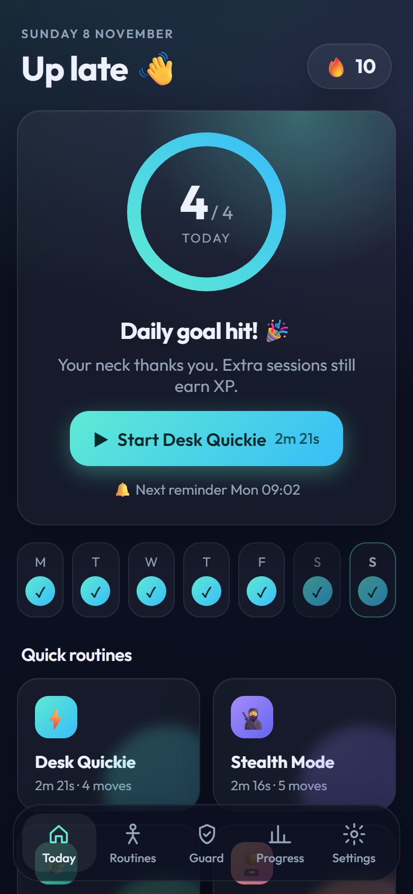
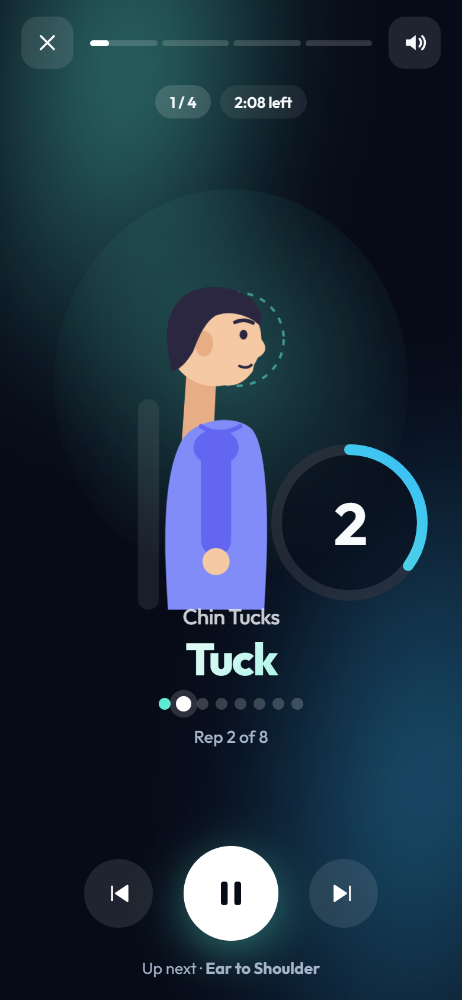
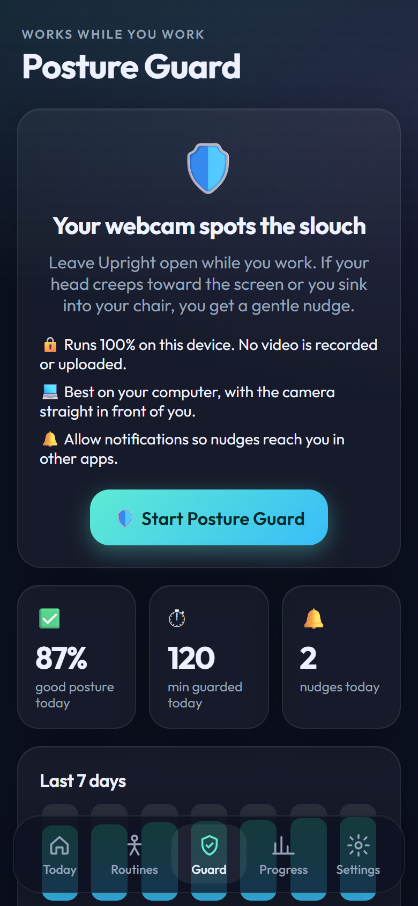
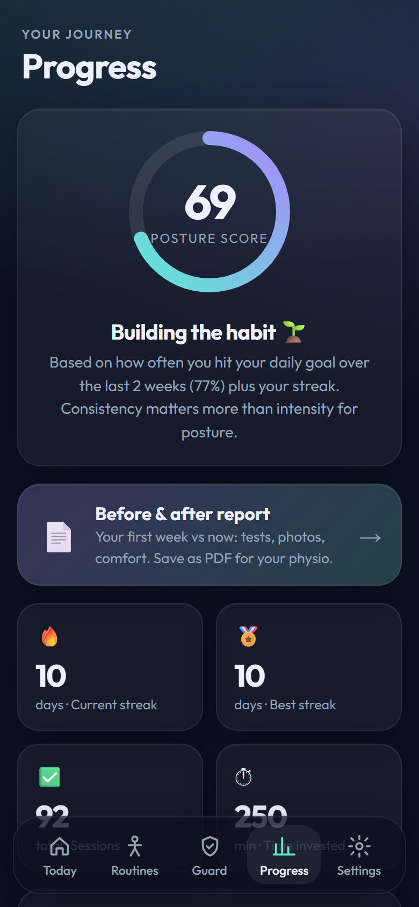
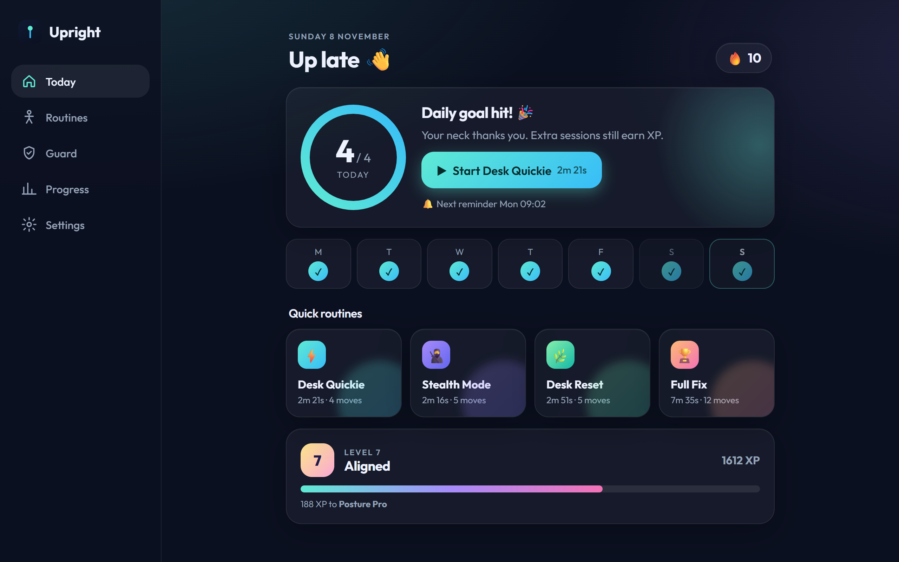

# Upright 🧘‍♂️ fix tech neck, one 2-minute break at a time

A free, open-source posture coach that runs in your browser and installs like an app on your phone and computer.

- It **reminds you** to take neck breaks as often as you choose.
- It **does the exercises with you**, with an animated coach, countdowns, chimes and an optional voice.
- Your **webcam can watch for slouching** while you work, with everything processed on your own device.
- It has **gym workouts for posture** and a **Learn** section explaining every exercise.
- It **tracks real progress**: streaks, a posture score, simple self-tests, and a before/after report you can show a physio.

<p align="center">
  
  
  
  
</p>

<p align="center"></p>

## ▶️ Try it: [oranges112.github.io/upright](https://oranges112.github.io/upright/)

Nothing to install or sign up for. Open the link on your phone or computer, and use your browser's **Install app** / **Add to Home Screen** to keep it like a normal app. Everything you do is saved privately in your own browser.

> I built this because I have tech neck. It's free, has no account, no ads and no tracking.

**The online version vs hosting your own:** the link above has everything (exercises, reminders while it's open, Posture Guard, the floating widget, progress and reports). Host your own copy (guide below, ~10 minutes) to also get **reminders when the app is closed** and **syncing between your phone and computer**.

## Features

| | |
|---|---|
| **🏃 Guided routines** | Desk Quickie (~2 min), Stealth Mode (discreet, for the office), Desk Reset (~3 min), Full Fix (~8 min). 12 physio-style exercises: chin tucks, ear-to-shoulder, levator and upper-trap stretches, rotations, shoulder squeezes, W-to-Y, chest opener, back extension and more. |
| **🎬 Exercises done with you** | An animated figure moves in sync with a countdown ring, rep dots and left/right switching. Gentle bell chimes, an optional ambient pad and voice coach. Keyboard shortcuts and screen wake-lock. |
| **🏋️ Gym workouts** | Three posture plans (Upper back, Back + core & hips, Quick 20) with 12 animated gym moves: rows, face pulls, pulldowns, Y-raises, head lifts, glute bridges, dead bugs and stretches. Tap "Set done" for a rest timer, timed holds for stretches, and remembered weights. |
| **📚 Learn** | Read about any exercise without doing it: how to do it, why it helps, where to feel it, common mistakes, easier and harder versions. Plus short guides on desk setup, phone posture, sleep, standing posture, gym rules, timelines and when to see a physio. |
| **💪 Intensity levels** | Gentle → Athlete. Strength moves get longer holds and more reps, stretches stay capped at a safe 30 s, and mobility moves stay easy. After each session it asks "Too easy / Just right / Too hard" and adjusts. |
| **🔔 Reminders** | Set the interval, active hours and days, with push notifications that have **Start now** and **Snooze** buttons. They work with the app closed, on phone and desktop. |
| **🛡️ Posture Guard** | Your webcam spots a forward head, slumping, chin dropping and head tilt, then nudges you with a chime and notification. It keeps checking while you look at a second screen or turn away, and tells you to recalibrate if your laptop or camera moves. Runs **100% on-device** (MediaPipe); no video ever leaves your computer. |
| **🪟 Floating widget** | A tiny always-on-top pill shows your posture live over any app, with what you're doing wrong and how to fix it (Chrome/Edge desktop). |
| **📈 Progress** | Streaks, XP and levels, a posture score, heatmap, weekly practice vs. neck-comfort chart, plus three self-tests: neck endurance hold, wall test, and a **side-profile photo** that measures your forward-head angle. |
| **📄 Before & after report** | Compares your first week with the last 7 days, with photos side by side. Print or save as PDF. |
| **🔄 Sync without accounts** | Link your phone and computer with a private code; streaks merge automatically. Photos stay on the device. |
| **🌙 Dark mode, offline, installable** | A PWA that works offline and installs from the browser. |

## 🪟 Desktop widget (Windows)

A tiny see-through dot that sits on top of every app. It's faded green while your posture is good, and pops out red with what's wrong ("Head forward · Slide your chin back") when you slouch. Drag it anywhere; right-click it (or the tray icon) to recalibrate, pause, or open the full app.

**[⬇️ Download the Windows installer](https://github.com/Oranges112/upright/releases/latest/download/Upright-Setup.exe)** and open it: it installs in a few seconds and starts the widget. (Prefer no install? Get `Upright-Portable.exe` from [Releases](https://github.com/Oranges112/upright/releases).) You can also download it from the **Guard** tab inside the app. Windows may warn that the app isn't from a known publisher, because it isn't code-signed: click **More info → Run anyway**.

To build it yourself: `cd desktop && npm install && npm run dist`. To point it at your own copy of Upright (for sync), edit `url` in `%APPDATA%\Upright\config.json`.

## Host your own copy (about 10 minutes, free tiers)

You need a free GitHub account and a free [Vercel](https://vercel.com) account.

### 1. Copy the code
Click **Fork** at the top of this page (or download the ZIP and push it to your own repo).

### 2. Import it into Vercel
vercel.com → **Add New → Project** → pick your fork → **Deploy**. That's enough for a working app: without the steps below, everything works but data stays on each device and reminders only fire while the app is open.

### 3. Turn on sync (Upstash Redis)
In your Vercel project: **Storage → Create Database → Upstash for Redis** → free plan → connect to the project. This adds `KV_REST_API_URL` and `KV_REST_API_TOKEN` automatically.

### 4. Turn on push notifications
On your computer, in the project folder:
```bash
npm install
npm run vapid
```
This prints a key pair. In Vercel → **Settings → Environment Variables**, add:

| Name | Value |
|---|---|
| `VAPID_PUBLIC_KEY` | the public key |
| `VAPID_PRIVATE_KEY` | the private key |
| `VAPID_SUBJECT` | `mailto:you@example.com` (your email) |
| `CRON_SECRET` | any long random string |

Then **Deployments → ⋯ → Redeploy**.

### 5. Turn on background reminders
Something needs to ping `/api/cron` every 5 minutes (Vercel's free plan only allows daily crons). Pick one:

- **Upstash QStash (easiest):** in Vercel, **Storage → Upstash QStash** → free plan → connect, then redeploy. Then run once:
  ```bash
  curl -X POST https://YOUR-APP.vercel.app/api/setup-schedule -H "Authorization: Bearer YOUR_CRON_SECRET"
  ```
- **cron-job.org (free):** a job hitting `https://YOUR-APP.vercel.app/api/cron` every 5 minutes with header `Authorization: Bearer YOUR_CRON_SECRET`.

### 6. Install it on your devices
- **Computer (Chrome/Edge):** install icon in the address bar → Settings → **Turn on notifications**.
- **Android:** Chrome menu → **Install app**.
- **iPhone:** Safari → Share → **Add to Home Screen**, then open it from the Home Screen and turn on notifications (iOS 16.4+).
- **Link devices:** Settings → Your devices → **Share link**, and open it on the other device.

## Run locally

```bash
npm install
npm run dev
```
Open http://localhost:3000. Copy `.env.example` to `.env.local` if you want sync and push locally.

## How it works

```
phone / laptop (PWA) ──sync──▶ /api/sync ──▶ Upstash Redis   (settings, sessions, tests)
        ▲                                         ▲
        │ web push                                │
   /api/cron  ◀── QStash / cron-job.org, every 5 min   (works out who's due, in their timezone)
```

| File | What's in it |
|---|---|
| `src/lib/exercises.ts` | Exercises, routines, intensity levels. Add your own here. |
| `src/lib/guard.ts` | Posture Guard: face landmarks → forward / slump / chin-drop / tilt checks. |
| `src/lib/schedule.ts` | Reminder logic, shared by browser and server. |
| `src/lib/stats.ts` | Streaks, XP, posture score. |
| `src/lib/sound.ts` | Web Audio chimes, ambient pad, voice. |
| `src/components/Player.tsx` | The guided session. |
| `public/sw.js` | Service worker: offline, push, notification buttons. |

Built with Next.js, React, TypeScript, MediaPipe Tasks Vision, Upstash and Web Push. No UI framework, just CSS.

## Privacy

- No accounts, analytics or ads.
- Posture Guard runs entirely in your browser. Camera frames are never stored or uploaded.
- Side-profile photos stay on the device that took them; only the angle number syncs.
- Your sync code is like a password to your progress. Don't share it publicly.

## Contributing

Ideas, bug reports and pull requests are welcome. Good first ideas: new exercises, translations, a custom routine builder.

## Disclaimer

Upright is a habit tool, not medical advice. If you have sharp pain, numbness, tingling or dizziness, stop and see a physio or doctor.

## License

[MIT](LICENSE). Use it, change it, share it.
